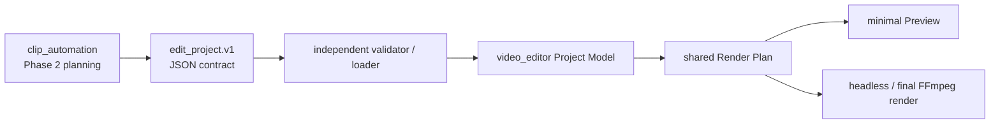
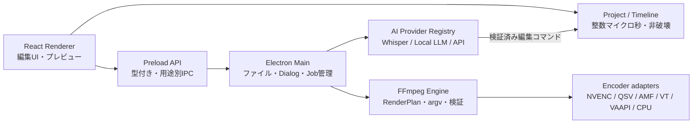
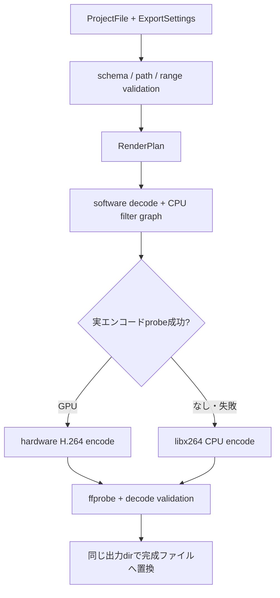

# アーキテクチャ

更新日: 2026-08-13
対象: Spectra Video Studio 0.1.x

## clip_automationとの境界（Phase 3）

video_editorは`clip_automation`の内部moduleをimportせず、version付き`edit_project.v1`だけを入力契約として扱う。`edit_project.json`単体または動画ファイルを開けることを前提にし、source mediaのrelative pathはJSON自身のparent directoryから解決する。`run_dir`、現在のworking directory、呼び出し元のpipeline状態には依存しない。

`caption_project.v2.json`と`transcript_words.json`は字幕・transcriptモデルとしてclip_automation側に残り、video_editorへは変換済みの`edit_project.v1`だけを渡す。内部の`linkGroupId`は`.spectra` Project Modelにのみ存在し、正式contractへ逆輸出しない。Phase 4ではcontract import時の厳密なV/A pair推論と手動linked editingを実装するが、旧pipeline統合は行わない。

## 設計目標

1. Windows / macOS / Linuxへ移植できること。
2. AMD・Intel・NVIDIA・AppleのGPU有無にかかわらず書き出しを完走すること。
3. 編集操作、AI操作、読み込み、書き出しを疎結合にし、増改築しやすくすること。
4. プロジェクトを非破壊で保存し、別PCで素材を再リンクできること。
5. RendererへNode.jsや任意コマンド実行能力を渡さないこと。
6. Production Electron rendererは`file://`で開くため、Vite outputのasset URLはfile-relativeでなければならない。startup smokeはHTML asset、DOM、preload、renderer diagnosticsを確認する。

## 全体構成

### Renderer

- Reactでメディア棚、合成プレビュー、インスペクター、タイムライン、書き出し画面を構成する。
- `window.spectra`の限定APIだけを利用する。
- 編集は純粋なProject操作へ変換し、履歴へ積む。外部プロセスを直接起動しない。
- Electron外のブラウザーではデモプロジェクトへフォールバックし、画面単体を検証できる。

### Preload / IPC

- `contextIsolation: true`、`sandbox: true`、`nodeIntegration: false`。
- `ipcRenderer`自体は公開せず、用途別関数だけを公開する。
- OSからドロップされた`File`のパス取得はElectron公式`webUtils.getPathForFile()`だけで行う。
- Main側で送信元URL、配列数、絶対パス、数値範囲、Project schemaを再検証する。

### Project / Timeline

- 時刻の正本は整数マイクロ秒。UI表示時だけフレーム／秒へ変換する。
- 素材ファイル自体を変更せず、`sourceInUs`、`startUs`、`durationUs`と効果パラメーターを保存する。
- legacy `.spectra`のVideo clipは`sourceAudioEnabled`未指定なら元動画の音声を内包できる。contract importのVideo clipは映像のみで、Audio clipが音声を表す。V/Aの手動同期関係は内部`linkGroupId`で管理する。
- linked move／trim／split／deleteは共有domain operationでatomicに処理し、相手trackがlockedなら全体を拒否する。rippleは削除intervalをmergeし、同一区間のV/Aを二重countしない。
- Cropは入力寸法に対する0.0〜0.49の正規化比率、Positionは出力中心からのpixel、Scaleは倍率。
- 保存時は素材の絶対パスとプロジェクト基準相対パスを保持し、読込時は相対パスを優先する。
- 素材不明時はofflineにし、元ファイルを削除せず再リンクを促す。

## 書き出しパイプライン

- 入力ごとにtrimし、解像度・SAR・fps・音声形式を正規化してから合成する。
- Crop、Scale、Position、Opacity、字幕、音声mixは互換性を優先してsoftware filterで処理する。
- 初版ではGPU decodeを強制しない。GPU↔CPU転送や非対応filterによる不安定化を避けるためである。
- FFmpegはshell文字列ではなく`spawn(binary, argv, { shell: false })`で実行する。
- GPUは`-encoders`列挙だけで判断せず、候補ごとに短い実エンコードを行う。
- 自動モードは利用可能なhardware encoderを試し、実書き出し失敗時は別一時ファイルで次候補、最後にCPUを試す。
- cancel、空き容量不足、権限不足等は無条件fallbackで隠さず、原因を返す。
- 完成前は`*.partial.*`を使い、既存完成ファイルや入力素材を壊さない。

## AI拡張境界

AIはProject JSONを直接書き換えない。Providerへ渡すのはローカルパスを除いた要約で、戻り値は次の順に処理する。

1. provider固有の応答を`unknown`として受信。
2. サイズ、型、capability、ID、時刻範囲をruntime validation。
3. 許可された編集コマンドへ変換。
4. 現Projectに対して対象存在・lock・stale revisionを再検証。
5. 差分プレビューを表示。
6. ユーザー承認後、通常編集と同じ履歴へ適用。
7. Undoで一括して戻せるようにする。

詳細は [AI_EXTENSION_GUIDE.md](./AI_EXTENSION_GUIDE.md) を参照する。

## 拡張ポイント

- `src/main/ai/provider.ts`: AI provider追加。
- `src/main/ffmpeg/encoders.ts`: encoder adapter追加。
- `src/main/ffmpeg/render-plan.ts`: clip/effectのFFmpeg変換追加。
- `SubtitleStyle.animation`: 字幕効果preset追加。
- Project schema変更時はversionを上げ、読み込みmigrationを先に作る。

## 意図的な制約

- 0.1.xの作業色空間はSDR BT.709を対象とする。HDRの自動変換は未保証。
- FFmpeg binaryはtarget OS上で依存導入して同梱する。Windows上でmacOS完成物を正しく生成する運用は採らない。
- 高度なカラー管理、マルチカム、追跡、モーショングラフィックス、共同編集は次期以降。
- Premiere Pro / DaVinci Resolve / Final Cut Proの画面・ロゴ・素材は複製しない。
